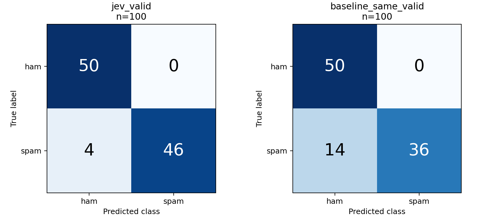
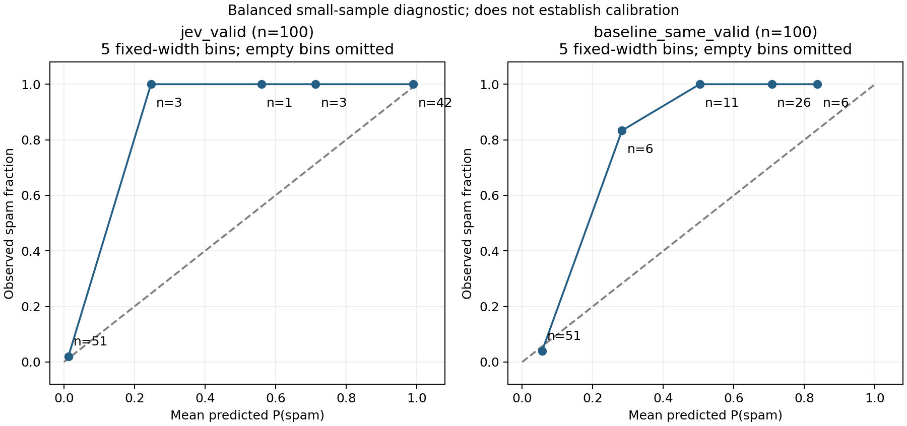

# Jev 短信过滤真实实验报告

实验日期：2026-10-01；本地 CPU 实验；未部署、未充值、未修改账户设置。

## 实测结论

**执行已跑完：真实数据、121 次真实 Jev 调用、基线训练、100 条测试集评测与文件交付全部完成。** 100 条测试请求均获得有效响应，没有失败、超时或未调用样本。Jev 分类准确率 96%，TF-IDF＋逻辑回归为 86%；Jev 概率策略自动处理 89 条，其余 11 条人工复核，在自动处理部分未观察到误拦或漏拦。含 smoke test、开发集、测试集的返回费用合计 **$0.002572878**。

可信度有明确边界：这是正常／垃圾各 50 条的平衡小样本；原始短信中发现 1 条 `ROMCAPspam` 疑似标签残留，可能带来文本内生答案线索。程序没有附加真实标签或预测标签，但严格的“原文完全不含答案线索”条件不能确认。本次未事后剔除该条或修改输入；它被两种模型都错分为 ham。不能将此次结果表述为无污染、无内生标签线索的严格基准。

最值得注意的三个发现：

1. Jev 比固定基线多识别 10 条垃圾短信：Spam Recall 为 92% 对 72%，两者均没有把正常短信分类为 spam。逐条配对中，11 条仅 Jev 正确、1 条仅基线正确。这是本划分的观察，不是同等训练条件下的通用排名。
2. 分类错误与自动操作错误不同。Jev 的 4 条错分全部进入复核，89% 覆盖率下观察到自动操作 89/89 正确；这不代表人工复核后的总体准确率是 100%，也不保证未来零误拦。
3. 概率仍需检验，费用与速度也需分开看。Jev Brier 较低，但中间分箱明显偏低估垃圾比例，且有的箱只有 1—3 条；本地基线单条预测约 0.096 毫秒，而 API 端到端中位数约 287 毫秒。零样本便利与联网开销之间存在实际取舍。

## 数据来源和预处理

实际公开下载来源：[Kaggle SMS Spam Collection Dataset](https://www.kaggle.com/datasets/uciml/sms-spam-collection-dataset)，下载接口为 `https://www.kaggle.com/api/v1/datasets/download/uciml/sms-spam-collection-dataset`。无需登录，没有访问或修改 Kaggle 凭据；UCI 备用路径未用于本次成绩。原始来源为 [UCI SMS Spam Collection](https://archive.ics.uci.edu/dataset/228/sms+spam+collection)，作者 Tiago Almeida、José Hidalgo，2011，DOI `10.24432/C5CC84`。

下载 ZIP 为 215,934 字节，含 `spam.csv`。保留原文件并按 Latin-1 解码，`v1` 为标签、`v2` 为文本。三个额外列 `Unnamed: 2/3/4` 分别有 50/12/6 个非空值，共涉及 50 行；未拼接进 `v2`。这些字段可能是导出残留或文本片段，本实验未重新解释或修复，因而结果精确对应 Kaggle 的 `v2` 字段，未证明每条都是完整无损原始短信。

| 检查 | 实测数量 |
|---|---:|
| 原始样本 | 5,572 |
| 原始 ham／spam | 4,825／747（86.59%／13.41%） |
| 缺失值行／空文本行／未知标签行 | 0／0／0 |
| 冲突标签文本组／剔除的冲突行 | 0／0 |
| 删除的相同文本重复行 | 403 |
| 清洗后样本 | 5,169 |
| 清洗后 ham／spam | 4,516／653（87.37%／12.63%） |

只以解码后的完整 `v2` 字符串比较重复，不统一大小写、不做 Unicode 归一化、不修正乱码；仅用 strip 检查是否空白。相同文本若标签冲突则剔除整组，否则保留首条。近重复文本不在本次删除范围内，可能跨集合存在。

SHA-256：

```text
kaggle.zip: 3e05b8e6e1e8fc9aef3ca69399a1bf3849a22084c8401d5d5d592e6c9a0e422b
spam.csv:   440e6ea9fa825578abfdd7b7932ef8393d72ef86c0c33f64676705ce40b1dfc2
dev.csv:    78747e2842e0f34e37a90e8317eae7b04686cbbd1b3543ae214f1d0c97a82113
test.csv:   d9aa60abe2697c1b4c13c496d7d2b371bf076d32d58f14cda471c6f60ec552d3
train.csv:  6ff08d969acc97760494f2225fe3cfe34f5276a35eafa309bf958544e8f30fa0
```

划分算法是 NumPy PCG64 `default_rng(42)`，分别随机排列 ham 和 spam，每类先取 10 条开发、再取 50 条测试，其余训练，最后打乱各集合。没有人工挑选；三集合精确文本交集均为空。

| 集合 | ham | spam | 合计 | 用途 |
|---|---:|---:|---:|---|
| 开发 | 10 | 10 | 20 | 检查流程及冻结标准 |
| 测试 | 50 | 50 | 100 | 一次固定评测 |
| 训练 | 4,456 | 593 | 5,049 | 仅训练传统基线 |

完整清单、逐条文本 SHA-256 和文件哈希见 `data/manifest.json` 与三个 CSV。文本内生标记审计见 `results/text_artifact_audit.json`；它属于运行后的数据质量观察，没有更改样本或主指标。

## 接入和冻结过程

调用前核实 [Jev 模型页面](https://openrouter.ai/typesafe/jev-1.13)、[官方教程](https://openrouter.ai/docs/guides/community/jev-tutorial)及 [Decisions API 文档](https://openrouter.ai/docs/api/api-reference/alphadecisions/submit-a-decisions-request)。使用 `POST https://openrouter.ai/api/alpha/decisions`，请求字段为 `model/state/questions`，问题为 `choice`、选项为 `ham/spam`；实际服务模型为 `typesafe/jev-1.13-20260917`，provider 为 TypeSafe。没有替换模型、调用 Jev Router 或训练 Jev。

API 的 state 只有 `sms_text`，没有额外传入真实标签、预测、样本 ID、集合名称或类别比例。标准用英文区分个人交流、预期服务通知与未经请求的推广、中奖诱导、付费回复和诈骗；明确不能仅凭 free、钱款、电话或链接判垃圾，并将短信当数据而非指令。完整标准在 `config/jev_v1.json` 与 `config/frozen.json`。

响应必须是对象、模型匹配指定版本系列、问题类型为 choice、类别合法、概率为有限数值且在 [0,1]、两个概率之和在 0.001 容差内等于 1。分类采用返回 choice，概率评分及策略采用 `probabilities.spam`，不将 confidence 当作预测正确率。此次 choice 与概率最大项没有不一致。

1 条自拟约饭短信 smoke test 成功，不计入开发或测试成绩。随后 20 条开发集成功，Accuracy 95%、Spam Recall 90%、Brier 0.04305；唯一错分的 spam（P(spam)=0.12）进入复核。保留初始 v1，修改轮数为 0。

配置冻结于 **2026-10-01 13:01:39 UTC**，首条测试请求于 **13:02:52 UTC**，冻结时间早于测试。判断标准、阈值、基线参数、划分均未依据测试成绩修改；没有测试集阈值探索。

工作流固定：P(spam) ≤ 0.10 放行；P(spam) ≥ 0.90 拦截；中间、失败、超时、异常或未调用均复核。

## 基线与比较条件

TF-IDF 单词 unigram＋bigram、`min_df=2`、`sublinear_tf=True`；逻辑回归 `C=1`、`class_weight=None`、`solver=liblinear`、`max_iter=1000`、随机种子 42。其余为锁定版 scikit-learn 1.7.2 的默认值。分类阈值为 0.5；不调参、不做校准。词表及分类器只在 5,049 条训练集拟合，词表为 12,005 项。基线仍保留训练集自然类别不平衡。

Jev 是零样本远程调用，基线是本数据集上的有监督训练，两者并非相同训练条件；比较用于选择实际工具。基线没有经过大规模调优，本结果不能代表 TF-IDF 或传统模型的最好成绩。基线概率受训练分布及正则化影响，不能因为此次固定阈值下覆盖率低就断言它无法用于自动化。

## 分类实测成绩

分类和概率指标只对有效 Jev 响应计算；本次有效子集恰好为全部 100 条，因此基线同一有效子集与基线全部测试成绩一致。失败 0、未调用 0；CSV 仍分列保存三种口径，避免未来失败时换分母。

| 指标 | Jev 有效响应（100） | 基线同一有效子集（100） | 基线全部测试（100） |
|---|---:|---:|---:|
| Accuracy | 96.00% | 86.00% | 86.00% |
| Balanced Accuracy | 96.00% | 86.00% | 86.00% |
| Spam Precision | 100.00%（46/46） | 100.00%（36/36） | 100.00%（36/36） |
| Spam Recall | 92.00%（46/50） | 72.00%（36/50） | 72.00%（36/50） |
| Spam F1 | 0.95833 | 0.83721 | 0.83721 |
| Brier score，越低越好 | 0.029149 | 0.097247 | 0.097247 |
| ham → spam | 0/50（0%） | 0/50（0%） | 0/50（0%） |
| spam → ham | 4/50（8%） | 14/50（28%） | 14/50（28%） |

混淆矩阵按真实标签行、预测列排列，顺序均为 ham、spam：Jev `[[50,0],[4,46]]`；基线 `[[50,0],[14,36]]`。



Brier 定义为平均 `(P(spam) − y)²`，spam 为 1、ham 为 0。它衡量整体概率预测误差，同时受区分能力和校准影响，较低不能独自证明已校准。

## 校准诊断

分箱预先固定为五个宽度 0.2 的概率区间，最后一箱含 1；图示每个非空箱样本数，完整统计见 `results/calibration_bins.csv`。

| P(spam) 区间 | Jev n | Jev 平均概率 | Jev 实际 spam 比例 | 基线 n | 基线平均概率 | 基线实际 spam 比例 |
|---|---:|---:|---:|---:|---:|---:|
| [0,0.2) | 51 | 0.01255 | 0.01961 | 51 | 0.05617 | 0.03922 |
| [0.2,0.4) | 3 | 0.24667 | 1.00000 | 6 | 0.28285 | 0.83333 |
| [0.4,0.6) | 1 | 0.56000 | 1.00000 | 11 | 0.50303 | 1.00000 |
| [0.6,0.8) | 3 | 0.71333 | 1.00000 | 26 | 0.70726 | 1.00000 |
| [0.8,1] | 42 | 0.98976 | 1.00000 | 6 | 0.83701 | 1.00000 |



Jev 有 72 条概率为 0 或 1；端点集中和自动处理样本零错误均不能证明普遍概率可靠。中间分箱观察到概率低于垃圾比例，但 Jev 这几个箱只有 1—3 条，波动很大。基线中间分箱也出现低估，与自然不平衡训练、未校准及平衡测试设计相容；本实验不能据此识别唯一原因。

测试集 spam 占 50%，清洗后全库约 12.63%，训练集约 11.74%。Precision、Brier、校准曲线和转人工比例与类先验有关，不能直接视为真实流量效果；本次没有做真实先验修正或另一个线上验证集。

## 概率工作流实测

以下均以**全部 100 条测试短信**为分母；不假设人工复核正确。自动准确率仅比较自动放行／拦截动作与数据集标签。基线用同一 0.10／0.90 策略作为辅助对照。

| 指标 | Jev | 基线 |
|---|---:|---:|
| 放行／拦截／复核 | 48／41／11 | 45／0／55 |
| 自动化覆盖率 | 89%（89/100） | 45%（45/100） |
| 人工复核比例 | 11%（11/100） | 55%（55/100） |
| 自动处理正确率 | 100%（89/89） | 95.56%（43/45） |
| 自动拦截中的误拦 | 0/41 | 0；没有自动拦截，条件比例不适用 |
| 自动放行中的漏拦 | 0/48 | 2/45（4.44%） |

Jev 的复核队列包含 9 条 spam、2 条 ham，其中 4 条是分类错分，5 条虽分类正确但概率不足以自动拦截。可见复核不是只接收错误，也会降低自动覆盖。没有测试实际复核员、复核耗时、成本或错误率，最终业务准确率未知。

## 最多十条代表性错误

按预测类别概率降序选取十个错误预测（9 条不同短信，其中一条被两种模型错分）。下面是措辞层面的解释假设，不是模型内部推理；所有真实标签都是 spam、预测都是 ham。完整短信保留在错误 CSV，不根据这些案例改提示词或阈值。

| 模型与 sample_id | P(spam) | 动作 | 可观察内容与解释边界 |
|---|---:|---|---|
| 基线 `b78ecc0cfdded3c3` | 0.07864 | 放行 | `ROMCAPspam Everyone around…`，主体像鼓励性话语，词袋可能缺少营销信号；含疑似标签／来源残留，且标签所需上下文不足。最高预测类别概率错误（P(ham)=0.92136）。 |
| 基线 `b44c5b43efd37886` | 0.08627 | 放行 | `Babe: U want me… Txt XXX SLO(4msgs)`，写成私人调情但以短码回复诱导收尾；基线漏拦，P(ham)=0.91373。 |
| Jev `c2e92231c2a17311` | 0.18 | 复核 | `Thanks for your Ringtone Order… GBP 4 per week`，伪装成已有订购通知；符合正常服务通知的表面形式，但数据集标 spam。缺少用户真实订购记录，不能仅凭文本核实同意。 |
| 基线 `04e9e55d253c9b19` | 0.22483 | 复核 | `Bought one ringtone and now getting texts…`，像用户对付费短信的抱怨而不是推广本身；标注含义或语境值得核查，但本次严格按原标签评分。 |
| Jev `7f0f344f17b6ba5b` | 0.23 | 复核 | `Thanks for using the Auction Subscription Service…`，带每条收费、退订命令，仍可能被表面服务通知形式干扰；不据此断言模型实际原因。 |
| Jev `fc8f15af8a87f58b` | 0.23 | 复核 | `A link to your picture has been sent…`，短通知缺少明显广告承诺，是否为预期图片分享需要外部上下文；本策略没有单凭链接判 spam。 |
| 基线 `4dd64aa7e371f02f` | 0.24877 | 复核 | `88066 FROM 88066 LOST 3POUND HELP`，非常短、短码和扣费线索突出，但语言零碎。 |
| 基线 `4c99448610bcbfa8` | 0.26473 | 复核 | `Reply G now… only 18p/txt`，付费订阅邀请的整体意图比普通词语重要。 |
| Jev `b78ecc0cfdded3c3` | 0.28 | 复核 | 同一鼓励性文本与疑似来源标记；Jev 也错分，但概率不足以自动放行。 |
| 基线 `01562055436f6d79` | 0.34686 | 复核 | 成人营销、短码回复及费用提示并存；原文还有 `å£` 编码痕迹，数据表征并不理想。 |

Jev 四条分类错误的 P(ham) 为 0.82、0.77、0.77、0.72，均未达到自动放行标准；基线两个 P(ham)>0.90 的错误实际被放行。这个差异说明要分别评价“返回类别”“概率”“最终动作”。

## 耗时、成功率和费用

| 项目 | 实测 |
|---|---:|
| 测试 API 成功率 | 100/100 = 100% |
| 测试失败／超时／异常／未调用 | 0／0／0／0 |
| 测试端到端延迟 P50／P95 | 0.28669 秒／0.39192 秒 |
| 全部 API 请求 | 121：smoke 1＋开发 20＋测试 100 |
| smoke 返回费用 | $0.000020580 |
| 开发返回费用 | $0.000422184 |
| 测试返回费用 | $0.002130114 |
| 全部已知返回费用 | **$0.002572878** |
| 费用不明请求 | 0 |
| 基线训练 | 0.04963 秒 |
| 基线批量预测 100 条 | 0.001237 秒 |
| 基线单条预测 P50／P95 | 0.09560／0.11248 毫秒 |

API 端到端计时包含本机请求、网络、服务及响应解析；复用串行 Session，无并发。基线是已载入模型后的文本转特征＋概率预测，不含首次 import、下载、环境安装或磁盘加载。网络 API 与本地 CPU 的耗时口径不同，表中清楚保留，不能将其归因于模型计算速度本身。

官方当前价格输入 $0.042／百万 token，输出免费；实际按 `usage.cost` 累计，不用价格估算代替返回费用。目标为 $0.10，本次远低于目标；没有账单级硬限额。虽然本次没有超时及费用不明项，返回统计仍不等同账户账单，超时和中断在其他运行中可能已经计费，以账户实际账单为准。

连接超时 10 秒、读取超时 30 秒，顺序逐条调用、不自动重试。配置错误立即停；连续三次失败停；费用缺失或超时更保守地立即停止，核对计费前不重发。持久化开始事件确保中断后不会无声重复请求。缓存键包含数据、文本、模型及判断标准版本；重算使用原始结果，不产生 API 请求。

## 复现证据与局限

独立环境 Python 3.12.13、NumPy 2.5.3、pandas 2.3.3、scikit-learn 1.7.2、SciPy 1.18.1、Matplotlib 3.10.9、requests 2.34.2；完整依赖锁在 `uv.lock` 和 `requirements.lock.txt`。操作系统、解释器、版本见 `results/environment.json`。本地密钥只暂存于预先忽略的 600 权限 `.env`，验收扫描后已删除；没有源代码、报告、日志、归档或 Git 中的密钥。

必要校验覆盖真实划分重复／冲突／无重叠、输入只有短信文本、响应类型／模型／概率边界、手算混淆矩阵和 Brier、工作流边界和全量分母、校准端点与分箱计数。最终另核对 121 个开始／结束事件、原始响应重新解析、冻结先于测试、每条 CSV 与缓存对应、费用求和和缓存复跑零新增请求。图表已实际生成并目视检查。

本实验未证明概率已校准、真实流量稳定性、人工复核质量或最佳传统基线。零误拦只是在 50 条正常短信与 41 条自动拦截中没有观察到错误；样本很小，不代表真实误拦率等于零。原始文件额外字段、编码痕迹、内生标记、近重复和可能有争议的标签进一步限制解释。经典公开数据可能进入模型预训练，无法排除污染；没有新增独立语料验证。

**能力边界：本实验只检验文本分类和简单分流，不能证明通用规划、因果决策或强化学习控制能力。** 决策策略是程序按固定阈值实现的，不是学到的最优策略。

复算命令（不联网、不产生费用）：

```sh
cd /Users/abc/Desktop/jev/jev-sms-experiment
.venv/bin/python experiment.py reproduce
```

文件索引及环境配置见 [README.md](README.md)；实训／黑客松的一页说明见 [ONE_PAGE.md](ONE_PAGE.md)。所有成绩都是实测，没有用合成数据、mock 响应或伪造预测替代。
